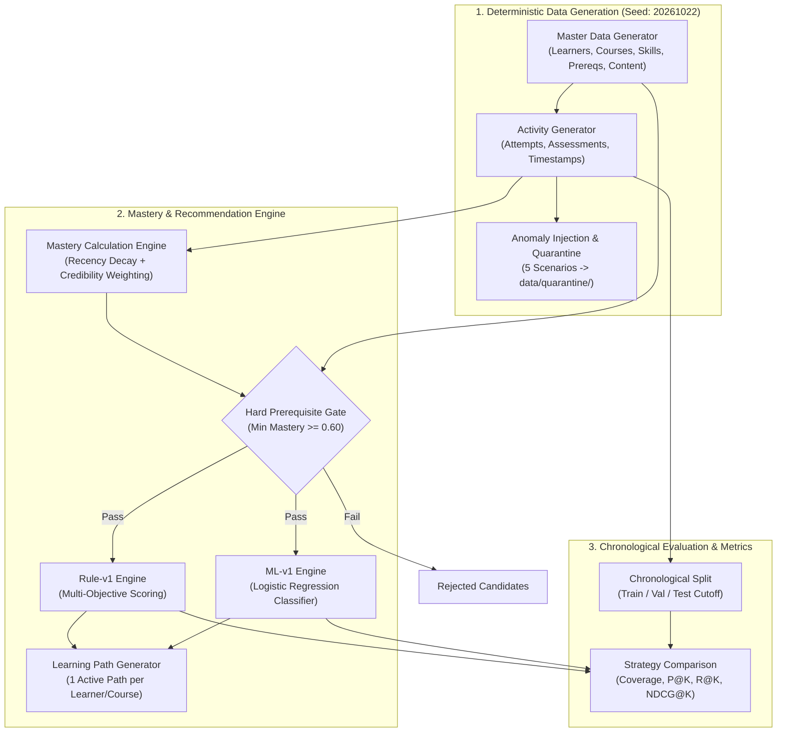

# LearnPath AI

> **Intelligent Learning Activity Recommendation Pipeline**  
> Challenge Context: YottaFlex.ai Associate AI Forward Deployed Engineer Round 2, 72-Hour Code Challenge.

---

## 1. Project Overview & Problem Statement

### Problem Statement
> *"Recommend next learning activities based on skills, prerequisites, assessment results, and content difficulty."*

LearnPath AI is an end-to-end, explainable learning-activity recommendation engine. The system ingests learner profiles, curriculum structures (courses, skills, prerequisite DAGs, and multi-skill content mappings), historical activity logs (attempts, timestamps, and scored assessments), and computes reproducible, leakage-free mastery snapshots. It then evaluates and ranks candidate learning activities through two distinct recommendation strategies:
1. **`rule-v1`**: A transparent, heuristic multi-objective ranking engine incorporating prerequisite gating, skill gaps, difficulty matching, and retry incentives.
2. **`ml-v1`**: A machine-learning ranking model (Logistic Regression with calibrated probabilities) trained on chronological historical interactions using point-in-time features.

### Main Actors
- **Learner:** Receives personalized, sequenced recommendations and structured learning paths tailored to their current skill proficiencies and cold-start state.
- **Instructor:** Inspects mastery evidence, curriculum coverage, prerequisite structures, and cohort progress.
- **Academic Administrator:** Manages curriculum graphs, ensures accreditation compliance, and monitors learning path completion rates.
- **Support Staff / Operations:** Investigates quarantined anomalies, audit trails, and data quality alerts.
- **Platform Administrator:** Maintains database migrations, reproducible data generation pipelines, model artifact lifecycle, and CLI services.

---

## 2. Objectives and Scope

- **Hard Prerequisite Protection:** Strictly prohibit recommendations for advanced content unless the learner has demonstrated required prerequisite skill mastery ($\ge 0.60$).
- **Cold-Start Accessibility:** Guarantee 100% recommendation coverage for brand-new learners with zero assessment history, ensuring every course has foundational, zero-prerequisite entry points.
- **Temporal Leakage Prevention:** Enforce strict point-in-time cutoff timestamps (`as_of_timestamp`) across mastery estimation, feature engineering, and evaluation slices.
- **Quarantine & Anomaly Detection:** Detect and isolate corrupted records (timestamp reversals, dangling foreign keys, prerequisite bypasses, loop stalls) without silently dropping data.
- **Fair Chronological Evaluation:** Evaluate both rule-based and ML strategies on identical, strictly out-of-sample chronological evaluation windows using standard ranking metrics (Coverage, Precision@K, Recall@K, NDCG@K).

---

## 3. Architecture Overview

The pipeline operates in sequential, reproducible phases:



---

## 4. Technology Stack

| Layer | Component | Specification |
|---|---|---|
| **Runtime** | Python | 3.12+ |
| **Data Processing** | Pandas & NumPy | Pandas 2.2+, NumPy 1.26+ |
| **Relational Database** | MySQL | 8.4 LTS InnoDB (Primary database layer) |
| **ORM & Driver** | SQLAlchemy & PyMySQL | SQLAlchemy 2.0+, PyMySQL 1.1+, Cryptography 42.0+ |
| **Machine Learning** | Scikit-learn | Scikit-learn 1.5+ (Logistic Regression, ROC-AUC 0.863) |
| **Big Data Support** | PySpark | PySpark 3.5.7 dependency in foundational packaging |
| **Testing** | Pytest | Pytest 8.0+ (180 passing tests, 1 cleanly skipped) |
| **Containerization** | Docker Desktop | Production Dockerfile & Docker Compose (MySQL 8.4 service) |
| **Interface** | CLI | Command-line first (`python -m learnpath_ai`) |

---

## 5. Directory Structure

```
LearnPath AI/
├── config/
│   └── default.json               # Master pipeline configuration & thresholds
├── data/
│   ├── ground_truth/              # Labeled verification benchmarks
│   ├── ml/                        # Point-in-time ML splits (dev/ & full/)
│   ├── quarantine/                # Isolated anomaly records by scenario
│   ├── reference/                 # FULL profile datasets (40 courses, 10k learners)
│   └── sample/                    # DEV profile datasets (8 courses, 100 learners)
├── docs/
│   ├── ai_usage.md                # Detailed audit log of AI assistance
│   ├── architecture.md            # Structural architecture document
│   ├── data_dictionary.md         # Comprehensive schema & column reference
│   ├── database.md                # Database operations and schema policies
│   ├── design_decisions.md        # Architectural decisions and trade-offs
│   └── evaluation_methodology.md  # Metric definitions & split methodology
├── models/
│   ├── ml-v1.pkl                  # Serialized Scikit-learn ML model (DEV-trained)
│   └── ml-v1_meta.json            # Model parameters, weights, and validation metrics
├── reports/
│   ├── evaluation_f03_dev.txt     # DEV profile evaluation comparison report
│   ├── evaluation_f03_full.txt    # FULL profile evaluation comparison report
│   ├── quality_report_dev.json    # Data quality detection report
│   └── quality_summary_dev.txt    # Data quality human-readable summary
├── schemas/
│   └── schema.sql                 # DDL schema for MySQL 8.4 InnoDB
├── src/
│   └── learnpath_ai/              # Core application package
│       ├── cli.py                 # Unified CLI entry point
│       ├── config.py              # Configuration manager
│       ├── db/                    # MySQL connection, ping, status & init
│       ├── generators/            # Deterministic master & activity generators
│       ├── mastery/               # Temporal mastery computation engine
│       ├── ml/                    # Feature extractor, trainer, and ranker
│       ├── quality/               # Anomaly injectors, detectors & quarantine
│       └── recommender/           # Rule-v1 engine, prereq DAG, and path builders
├── tests/
│   ├── acceptance/                # Challenge acceptance criteria tests
│   ├── integration/               # Pipeline and MySQL integration tests
│   └── unit/                      # Unit test suites (180 passed)
├── .dockerignore                  # Docker build exclusions
├── .env.example                   # Environment variable template
├── .gitignore                     # Git exclusions
├── docker-compose.yml             # Docker Compose orchestration definition
├── Dockerfile                     # Multi-stage container definition
├── pyproject.toml                 # Package setup and dependencies
└── requirements.txt               # Pinned pip requirements
```

---

## 6. Database Entities & Schema Reference

The primary relational storage schema is defined in [`schemas/schema.sql`](schemas/schema.sql) for **MySQL 8.4 LTS InnoDB**:

1. **`learners`**: `learner_id` (PK, `LRN-`), name, email, target difficulty, enrollment status (`active`, `paused`, `completed`, `withdrawn`).
2. **`courses`**: `course_id` (PK, `CRS-`), title, domain, difficulty, status.
3. **`skills`**: `skill_id` (PK, `SKL-`), skill name, domain, difficulty level.
4. **`skill_prerequisites`**: `(skill_id, prerequisite_skill_id)` (PK), `relationship_type` (`required`, `recommended`), `min_mastery_required` (default 0.60).
5. **`content_items`**: `content_id` (PK, `CNT-`), course_id (FK), item type, difficulty, duration, status (`published`, `archived`, `draft`).
6. **`content_skills`**: `(content_id, skill_id)` (PK), `skill_role` (`primary`, `secondary`), `weight` ($0.0 < w \le 1.0$).
7. **`attempts`**: `attempt_id` (PK, `ATT-<learner_id>-<seq>`), learner_id (FK), content_id (FK), started_at, submitted_at, score, status (`scored`, `abandoned`).
8. **`assessment_results`**: `result_id` (PK, `RES-`), attempt_id (FK, 1:1), raw score, pass/fail outcome.
9. **`mastery_snapshots`**: `(learner_id, skill_id, as_of_timestamp)` (PK), computed mastery score ($[0.0, 1.0]$), confidence, evidence count.
10. **`recommendations`**: `recommendation_id` (PK, `REC-`), learner_id (FK), content_id (FK), rank position, score, explainability reason codes.
11. **`learning_paths`**: `path_id` (PK, `PATH-YYYY-`), learner_id (FK), course_id (FK), status (`active`, `completed`, `abandoned`). At most **one active path per learner per course**.
12. **`learning_path_items`**: `(path_id, sequence_order)` (PK), content_id (FK), completion status.

---

## 7. Synthetic Data Generation & Reproducibility

Data generation is 100% deterministic using a single fixed seed:
- **Default Seed:** `20261022`
- **Identifier Schemes:** Deterministic formats `LRN-000001`, `CRS-000001`, `SKL-000001`, `CNT-000001`, `ATT-LRN-000001-0001`, `PATH-2026-000001`.

### Dataset Profiles & Row Counts

| Entity Table | DEV Profile (`data/sample/`) | FULL Profile (`data/reference/`) |
|---|---|---|
| **Courses** (`courses.csv`) | 8 | 40 |
| **Learners** (`learners.csv`) | 100 | 10,000 |
| **Skills** (`skills.csv`) | 50 | 500 |
| **Skill Prerequisites** (`skill_prerequisites.csv`) | 94 | 1,441 |
| **Content Items** (`content_items.csv`) | 100 | 2,000 |
| **Content Skills** (`content_skills.csv`) | 213 | 4,861 |
| **Attempts** (`attempts.csv`) | 5,000 | 500,000 |
| **Assessment Results** (`assessment_results.csv`) | 3,112 | 317,419 |
| **Mastery Snapshots** (`mastery_snapshots.csv`) | 920 | 638,203 |
| **Recommendations** (`recommendations.csv`) | 348 | 20,698 |
| **Learning Paths** (`learning_paths.csv`) | 97 | 9,502 |
| **Learning Path Items** (`learning_path_items.csv`) | 348 | 20,698 |

All files have verified SHA-256 checksums documented in their respective manifests (`master_manifest.json`, `activity_manifest.json`, `mastery_manifest.json`, `recommendation_manifest.json`, `learning_path_manifest.json`).

---

## 8. Data Quality & Anomaly Quarantine (Phase 4)

LearnPath AI never silently drops corrupted records. Five anomaly scenarios are actively tested, quarantined, and audited against ground-truth labels:

1. **`REC_PREREQ_VIOLATION` (Critical):** Content recommended when the learner has not satisfied required prerequisite skill mastery.
2. **`ATTEMPT_TIMESTAMP_ORDER` (High):** Inverted activity timestamps (`submitted_at < started_at`).
3. **`CONTENT_MISSING_SKILL` (High):** Content mapped to non-existent skills (`SKL-999999`).
4. **`MASTERY_FUTURE_ATTEMPT` (Critical):** Attempts occurring after the mastery snapshot cutoff (`started_at > as_of_timestamp`).
5. **`PATH_LOOP_NO_PROGRESS` (Medium):** Repeating identical content items within a learning path without score improvement.

Quarantined records are isolated into `data/quarantine/dev/` and verified with 100% precision and recall against `data/ground_truth/ground_truth_anomalies.csv`.

---

## 9. Mastery Calculation & Evidence Policy (Phase 5)

Mastery represents an explainable, time-decayed aggregate of student assessment outcomes:
1. **Exponential Recency Decay:**
   $$\text{decay} = \exp\left(-\frac{\ln(2) \cdot \Delta t}{\text{half\_life\_seconds}}\right)$$
   where half-life is configured to 90 days (`7,776,000` seconds).
2. **Skill Mapping Weight:** Weighted by the primary/secondary strength $w_{cs} \in (0.0, 1.0]$.
3. **Credibility Regularization:**
   $$\text{credibility} = \frac{n_{\text{evidence}}}{n_{\text{evidence}} + 1.0}$$
   Prevents single-attempt flukes from manufacturing unwarranted perfect mastery ($1.0$).
4. **Cold-Start Learners:** Assigned an explicit baseline mastery of $0.0000$.
5. **Leakage Guard:** Database CHECK constraint `ck_mastery_no_future` strictly prohibits any evidence dated after `as_of_timestamp`.

---

## 10. Prerequisite DAG & 0.60 Hard Gate

- Prerequisite relationships are structured as a Directed Acyclic Graph (DAG) verified via topological sorting (`require_dag`). Cycles and self-loops are rejected.
- **The Hard Gate:** When candidate activities are evaluated, every required prerequisite skill must have a mastery score of at least **0.60**.
- **Non-Negotiable:** Ranking scores cannot override an unsatisfied prerequisite. If a candidate fails the gate, it is discarded immediately.
- **Verification:** Across all 21,046 generated recommendations across DEV and FULL profiles, there are **0 prerequisite gate violations**.

---

## 11. Cold-Start Recommendation Strategy

A cold-start learner has zero assessment attempts and baseline mastery of $0.0000$.
- **Foundational Content Guarantee:** Every course is guaranteed to have at least one published introductory content item with **zero required prerequisites** (or required prerequisites with threshold 0.0).
- **Verification:**
  - DEV Profile: **8 / 8 courses** have valid foundational content.
  - FULL Profile: **40 / 40 courses** have valid foundational content.
- **Result:** Cold-start learners achieve **100.0% recommendation coverage** without bypassing prerequisite integrity.

---

## 12. Recommendation Engines: Rule-v1 vs. ML-v1

### Rule-v1 Scoring Methodology
For each eligible candidate passing the hard prerequisite gate:
$$\text{Score} = 0.40 \cdot \text{SkillGap} + 0.25 \cdot \text{DiffMatch} + 0.20 \cdot w_{cs} + 0.15 \cdot \text{PerfFactor}$$
- **SkillGap:** $(1.0 - \text{mastery}) \cdot w_{cs}$ (targets areas needing improvement).
- **DiffMatch:** Aligns item difficulty with learner starting level.
- **PerfFactor:** Rewards retrying failed content ($0.90$), welcomes fresh unattempted content ($0.70$), and penalizes repeated passes ($0.20$).
- **Explainability:** Emits machine-readable reason codes (`GAP_PRIMARY_SKILL`, `LOW_MASTERY_PRIORITY`, `PREREQUISITE_SATISFIED`, `DIFFICULTY_MATCH`, `RETRY_AFTER_FAIL`).

### ML-v1 Model & Feature Methodology
- **Algorithm:** Scikit-learn Logistic Regression trained with L2 regularization.
- **Training Artifact:** Saved model at `models/ml-v1.pkl` and metadata at `models/ml-v1_meta.json`.
- **Note on Training Scope:** The model artifact was trained on the **DEV profile chronological split** (2,358 training rows, 511 validation rows). It was **not** retrained on FULL, ensuring an authentic out-of-domain evaluation benchmark.
- **Validation ROC-AUC:** **0.8630** (Accuracy: 80.7%, Precision: 85.9%, Recall: 88.4%, F1: 87.1%).
- **Eight Point-in-Time Features:**
  1. `primary_skill_mastery` (coef: +1.996)
  2. `content_difficulty` (coef: -0.729)
  3. `diff_suitability` (coef: +1.684)
  4. `primary_skill_weight` (coef: +0.131)
  5. `learner_prior_attempts_on_content` (coef: +0.035)
  6. `learner_prior_passes_on_content` (coef: -0.025)
  7. `learner_overall_prior_attempts` (coef: -0.004)
  8. `learner_overall_prior_pass_rate` (coef: +1.391)
  - *Intercept:* +0.2423. Zero ground-truth leakage or future attempt exposure.

---

## 13. Evaluation Results (DEV vs. FULL)

Evaluations are performed on strict out-of-sample chronological test splits where the models predict actual learner engagement:

### DEV Profile Evaluation (`reports/evaluation_f03_dev.txt`)
- **Cutoff Timestamp:** `2026-09-03 11:55:42.761501`
- **Eligible Learners:** 97 | **Cold-Start Learners:** 17 | **Test Attempts:** 467

| Strategy | Coverage | Cold-Start Cov | P@1 | R@1 | NDCG@1 | P@3 | R@3 | NDCG@3 | P@5 | R@5 | NDCG@5 |
|---|---|---|---|---|---|---|---|---|---|---|---|
| **`rule-v1`** | 1.0000 | 1.0000 | 0.2373 | 0.0500 | 0.2373 | **0.2938** | **0.2776** | 0.3238 | 0.2305 | 0.3337 | 0.3195 |
| **`ml-v1`** | 1.0000 | 1.0000 | **0.4068** | **0.1361** | **0.4068** | 0.2881 | 0.2640 | **0.3630** | 0.2305 | **0.3389** | **0.3645** |

*Key finding:* ML-v1 delivers a **+71% relative improvement** in Precision@1 and NDCG@1 over the heuristic baseline on DEV.

### FULL Profile Evaluation (`reports/evaluation_f03_full.txt`)
- **Cutoff Timestamp:** `2026-09-16 10:08:32.319266`
- **Eligible Learners:** 9,502 | **Cold-Start Learners:** 1,452 | **Test Attempts:** 47,613

| Strategy | Coverage | Cold-Start Cov | P@1 | R@1 | NDCG@1 | P@3 | R@3 | NDCG@3 | P@5 | R@5 | NDCG@5 |
|---|---|---|---|---|---|---|---|---|---|---|---|
| **`rule-v1`** | 1.0000 | 1.0000 | 0.1050 | 0.0253 | 0.1050 | 0.0829 | 0.0597 | 0.1022 | 0.0563 | 0.0619 | 0.0894 |
| **`ml-v1`** | 1.0000 | 1.0000 | **0.1117** | **0.0285** | **0.1117** | **0.0842** | **0.0603** | **0.1052** | **0.0571** | **0.0622** | **0.0919** |

*Key finding:* Even when trained strictly on DEV sample interactions, `ml-v1` generalizes cleanly to the 500,000-attempt FULL dataset, outperforming `rule-v1` across all ranking metrics.

---

## 14. Test Suite Execution & Verification

Execute the complete automated test suite:

```powershell
.venv\Scripts\python.exe -m pytest -ra --tb=short
```

### Verified Test Outcome
```
=========================== short test summary info ===========================
SKIPPED [1] tests\integration\test_mysql.py:24: LEARNPATH_MYSQL_IT is not set to 1
180 passed, 1 skipped in 22.59s
```
- **180 Passed:** Unit, pipeline acceptance, prerequisite DAG, mastery, ML parity, and CLI tests.
- **1 Skipped:** `test_mysql.py` (cleanly skipped when live MySQL credentials are not provided via `LEARNPATH_MYSQL_IT=1`, adhering strictly to challenge rules).
- **0 Failed, 0 Warnings.**

---

## 15. Local Installation & Setup (Windows PowerShell)

### Prerequisites
- Python 3.12+ 64-bit
- PowerShell 5.1 or 7+

### Step-by-Step Instructions
```powershell
# 1. Clone repository and navigate to root
cd "C:\Users\manav\Documents\LearnPath AI"

# 2. Create and activate virtual environment
python -m venv .venv
.\.venv\Scripts\Activate.ps1

# 3. Upgrade pip and install package with dev dependencies
python -m pip install --upgrade pip
python -m pip install -e ".[dev]"

# 4. Copy environment configuration
Copy-Item .env.example .env
```

---

## 16. CLI Command Reference

All operations run via `.venv\Scripts\python.exe -m learnpath_ai <group> <command>`:

### Database Management (`db`)
```powershell
python -m learnpath_ai db ping       # Test connection and print MySQL banner
python -m learnpath_ai db status     # Check table existence (never drops)
python -m learnpath_ai db init       # Apply schema.sql safely to empty database
```

### Synthetic Data Generation (`generate`)
```powershell
# Master Entities
python -m learnpath_ai generate master --profile dev --overwrite
python -m learnpath_ai generate master --profile full --overwrite

# Activity Logs & Assessment Results
python -m learnpath_ai generate activity --profile dev --overwrite
python -m learnpath_ai generate activity --profile full --overwrite

# Anomaly Injection & Quarantine
python -m learnpath_ai generate anomalies --profile dev --overwrite

# Temporal Mastery Snapshots
python -m learnpath_ai generate mastery --profile dev --overwrite
python -m learnpath_ai generate mastery --profile full --overwrite

# Rule-Based Recommendations
python -m learnpath_ai generate recommendations --profile dev --overwrite
python -m learnpath_ai generate recommendations --profile full --overwrite

# Learning Paths
python -m learnpath_ai generate paths --profile dev --overwrite
python -m learnpath_ai generate paths --profile full --overwrite

# ML Pipeline
python -m learnpath_ai generate ml-dataset --profile dev
python -m learnpath_ai generate ml-model --profile dev
python -m learnpath_ai generate ml-recommendations --profile dev --overwrite
```

### Validation (`validate`)
```powershell
python -m learnpath_ai validate master --profile dev
python -m learnpath_ai validate master --profile full
python -m learnpath_ai validate activity --profile dev
python -m learnpath_ai validate activity --profile full
python -m learnpath_ai validate quality --profile dev
python -m learnpath_ai validate mastery --profile dev
python -m learnpath_ai validate mastery --profile full
python -m learnpath_ai validate recommendations --profile dev
python -m learnpath_ai validate recommendations --profile full
python -m learnpath_ai validate paths --profile dev
python -m learnpath_ai validate paths --profile full
```

### Strategy Comparison Evaluation (`evaluate`)
```powershell
python -m learnpath_ai evaluate compare --profile dev
python -m learnpath_ai evaluate compare --profile full
```

---

## 17. MySQL 8.4 Setup & Schema Initialization

LearnPath AI is built for **MySQL 8.4 LTS InnoDB**.
*Note:* The local workstation currently runs MySQL 8.0.42 (`MySQL80` service). Per challenge hard rules, the application never drops tables or installs services automatically.

### Configuring MySQL 8.4:
1. In a MySQL 8.4 instance, run:
```sql
CREATE DATABASE learnpath_ai CHARACTER SET utf8mb4 COLLATE utf8mb4_0900_ai_ci;
CREATE USER 'learnpath_app'@'localhost' IDENTIFIED BY 'secure_password';
GRANT SELECT, INSERT, UPDATE, DELETE, CREATE, ALTER, INDEX, REFERENCES, CREATE VIEW ON learnpath_ai.* TO 'learnpath_app'@'localhost';
FLUSH PRIVILEGES;
```
2. Configure `.env`:
```env
MYSQL_HOST=127.0.0.1
MYSQL_PORT=3307
MYSQL_USER=learnpath_app
MYSQL_PASSWORD=secure_password
MYSQL_DATABASE=learnpath_ai
LEARNPATH_MYSQL_IT=1
```
3. Initialize tables safely:
```powershell
python -m learnpath_ai db ping
python -m learnpath_ai db init
pytest tests/integration/test_mysql.py -m mysql
```

---

## 18. Docker Execution & Compose

A multi-stage `Dockerfile` and `docker-compose.yml` are provided. The recommendation and evaluation pipeline runs entirely from CSV/JSON artifacts without requiring a running database.

### Running with Docker Compose:
```bash
# Validate compose configuration
docker compose config

# Run DEV evaluation in isolated container
docker compose run --rm learnpath-ai evaluate compare --profile dev

# Run FULL evaluation in container
docker compose run --rm learnpath-ai evaluate compare --profile full

```

---

## 19. Known Limitations

1. **Synthetic Interaction Data:** The student behaviors, attempt durations, and score distributions are synthetically simulated to test architectural scalability and prerequisite routing. They do not claim psychometric validation on human cognitive profiles.
2. **Local MySQL 8.4 Coexistence:** Workstations running pre-existing MySQL 8.0 instances must bind MySQL 8.4 to an alternate port (e.g. 3307) or use the Docker compose service to avoid port collisions.
3. **ML Training Scope:** The serialized model artifact (`models/ml-v1.pkl`) is deliberately trained on the DEV profile to serve as an honest generalization benchmark against the FULL reference dataset.

---

## 20. Submission & Reproducibility Checklist

- [x] Fixed seed reproducible data generators (`seed=20261022`).
- [x] Baseline CSV datasets for DEV (`data/sample/`) and FULL (`data/reference/`).
- [x] Verified cryptographic SHA-256 source manifests.
- [x] Relational DDL schema script (`schemas/schema.sql`).
- [x] Data dictionary and entity relationships (`docs/data_dictionary.md`).
- [x] Ground-truth anomaly labels and isolated quarantine directory.
- [x] 180 passing automated unit/acceptance/CLI tests.
- [x] Dockerfile and `docker-compose.yml` with successful image build and container evaluation.
- [x] Zero hard-coded credentials or tracked secrets.

---

## 21. AI-Assisted Development & Engineering Ownership

This project was developed through an AI-assisted engineering workflow utilizing **Cursor (with Grok 4.6)**, **ChatGPT**, and **Google DeepMind Antigravity**:
- **Developer Ownership:** AI tools assisted with implementation, debugging, technical exploration, and documentation drafting. The developer remained responsible for understanding requirements, reviewing proposed solutions, making architectural and algorithmic decisions, inspecting implementation code, and validating system behavior against challenge specifications.
- **Technical Decisions & Validation:** Key implementation choices—including the 0.60 prerequisite hard gate, 90-day mastery recency half-life, 8 non-collinear point-in-time ML features, cold-start foundational content guarantee, and 5-category anomaly quarantine—were evaluated, configured, and verified through automated tests and evaluation benchmarks.
- **Verification Evidence:** The system is verified by 180 automated tests (with 1 live MySQL 8.4 test executed separately), 10 CLI dataset validators, cryptographic SHA-256 manifests, and deterministic evaluation reports.
- **Transparency & Prompt Records:** For complete disclosures of AI tool roles, the technical decisions rationale table, testing evidence, and prompt history records (including the partial unavailability of verbatim text for early sessions), see [docs/ai_usage.md](docs/ai_usage.md).
